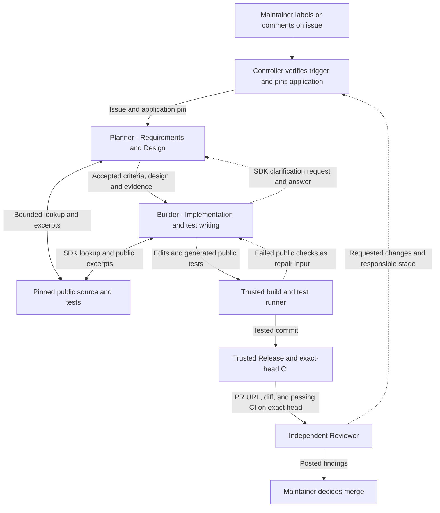

# AutoSE component view

A maintainer triggers the controller on the fork. The controller selects
the application revision, runs each stage, saves its artifacts, and decides
whether to advance, retry, or stop.

## Components and access

Planner, Builder and Reviewer can use the same Groq model in separate
conversations. Release is a trusted script. The controller enforces the
order and decides whether a stage may advance.

| Role | Inputs and tools | Handoff |
| --- | --- | --- |
| Planner | Issue, requirements skill, A2 architecture and pinned Git tree. Design can call `list_files`, `find_files`, `search_text` and `read_file`. | Passes the accepted criteria, `design.md`, and inspected excerpts to Builder. |
| Builder | Accepted plan and editable paths. The optional LangGraph backend adds the public lookup tools, `ask_planner`, `submit_edits`, and `submit_tests`. The trusted harness applies validated edits and runs checks. | Produces a compiled patch and a public test module. Testing receives the exact patch and runs the same tests on clean and candidate checkouts, plus the candidate full suite. |
| Release | Tested patch, base and commit evidence. The script verifies the fork and tested SHA, pushes the revision, opens or reuses the PR, and checks CI. | Passes the PR URL and exact head to the independent Reviewer after CI passes. |
| Reviewer | Fresh issue, diff and public repository at the PR head. Can inspect files and request the public suite through the isolated runner. | A separate trusted job posts the verdict. A change request records which stage should revise the candidate. |

## How an SDK tool call crosses components

LangGraph is a Python SDK that controls the Builder conversation. Groq still
generates the messages. The SDK follows a small loop that issues a request,
dispatches a named tool, and sends its result back as the next input.

For example, Builder can ask which default preserves string-valued
extension settings. The harness sends the question, accepted plan and
pinned excerpts to a focused Planner call. It records the reply and
delivers it as the result of `ask_planner`. Builder can read the cited code
and submit its edits. The next task writes tests from the exact patch and
public examples. The trusted runner launches candidate checks inside a read-only network-isolated container.
Private acceptance tests stay outside model context.

## Current verification

The demo workflow enables LangGraph with a maximum of one Planner
clarification per Implementation task. It runs Testing in an isolated
container so public evidence can drive one bounded repair before Release.
After a first-round change request, a maintainer updates the same PR and
requests a fresh second review. The new hosted route has local replay and
preflight evidence. See the [run ledger](../../results/runs.md).

## Baselines and failure evidence

Issue 2 uses 1e2b7f27aeefe70057025a1da0d10006dd11ad48 as its application
baseline and a3/bug02-seed as its PR base. Issues 1, 3, 4, and 5 use
2c96e36ba4750cf18583d62e2fcecff49e077419 as their application baseline.

Each stage records its input revision, artifacts, elapsed time, and outcome.
A model call also records the model ID, usage, provider finish reason, and
response-validation outcome. Passing a JSON format check alone does not
establish that every acceptance criterion is supported by the issue.
