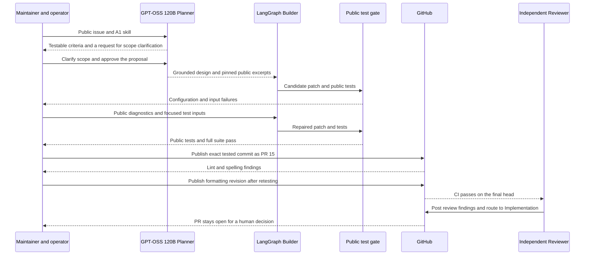

# Observed sequence for Issue 3 and PR 15

This was a guided run with live model calls and a real GitHub pull request.
The operator's interventions are shown explicitly.

The review requested changes and its main blocking claim was later contradicted
by inspection of the actual configuration flow. The published record preserves
both the model finding and the operator verification. [PR 15 and review](https://github.com/AKGIIITH/markdown/pull/15#pullrequestreview-5998959116)
