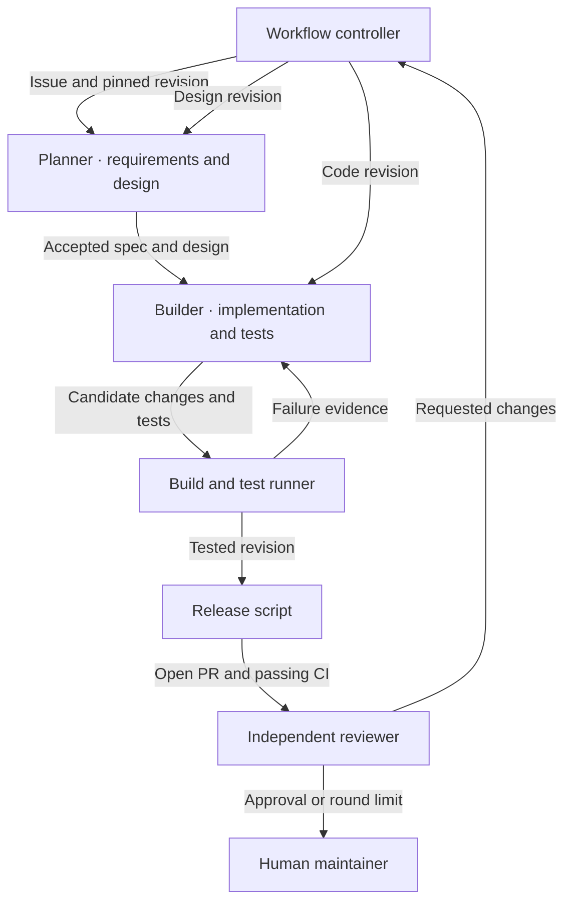

# A3 baseline component view

A maintainer triggers the controller on the fork. The controller selects
the application revision, runs each stage, saves its artifacts, and decides
whether to advance, retry, or stop.

## Components and access

- The Planner uses the A1 skill for requirements. At design time it can read
  the application source and the A2 architecture document.
- The Builder can inspect and edit its working checkout and write tests.
  It retains recent implementation context when entering the testing stage.
- The runner records commands, exit codes, timings, and test output.
  Private acceptance tests are reserved for evaluating the resulting revision.
- The release script publishes the tested revision to the fork, opens or
  reuses the pull request, and checks CI for its current head.
- Each review starts in a fresh context. The reviewer receives the issue,
  diff, and repository at the PR head. It may run checks. A separate
  trusted step publishes its verdict. Only a human decides whether to merge.

## Baselines and failure evidence

Issue 2 uses 1e2b7f27aeefe70057025a1da0d10006dd11ad48 as its application
baseline and a3/bug02-seed as its PR base. Issues 1, 3, 4, and 5 use
2c96e36ba4750cf18583d62e2fcecff49e077419 as their application baseline.

Each stage records its input revision, artifacts, elapsed time, and outcome.
A model call also records the model ID, usage, provider finish reason, and
response-validation outcome. Passing a JSON format check alone does not
establish that every acceptance criterion is supported by the issue.
